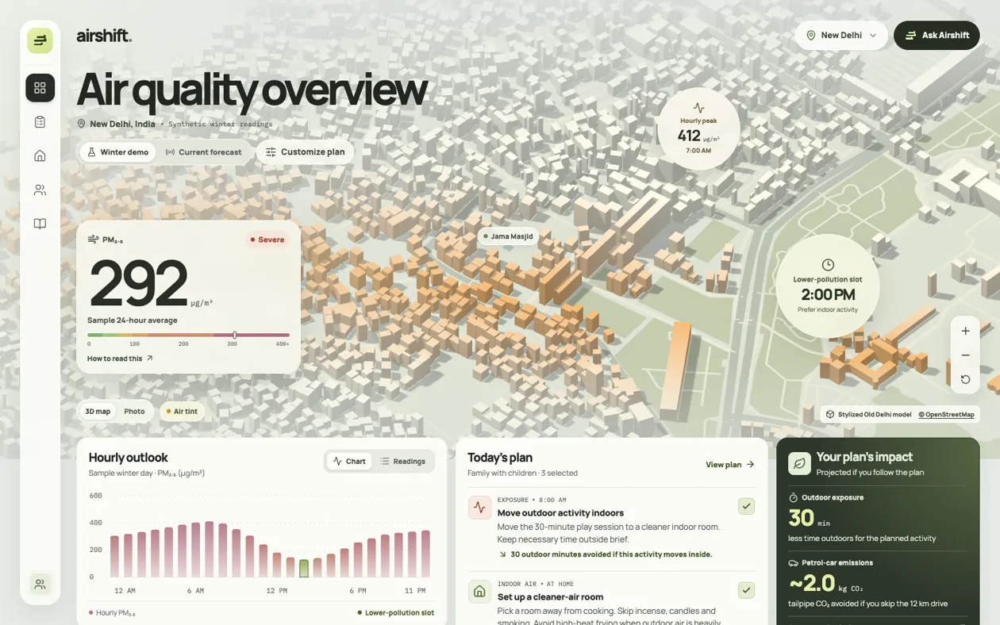
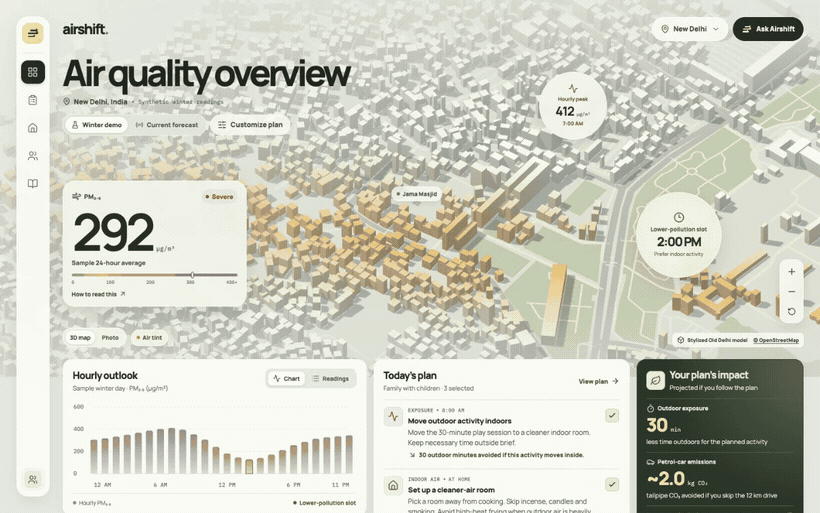
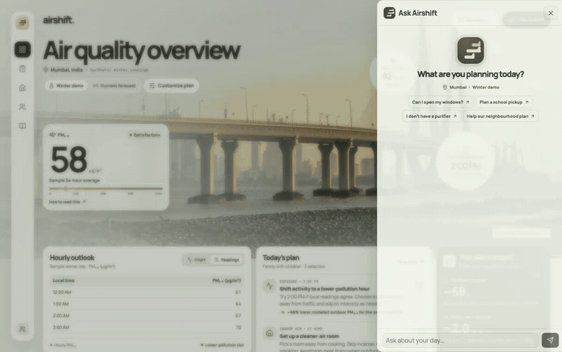
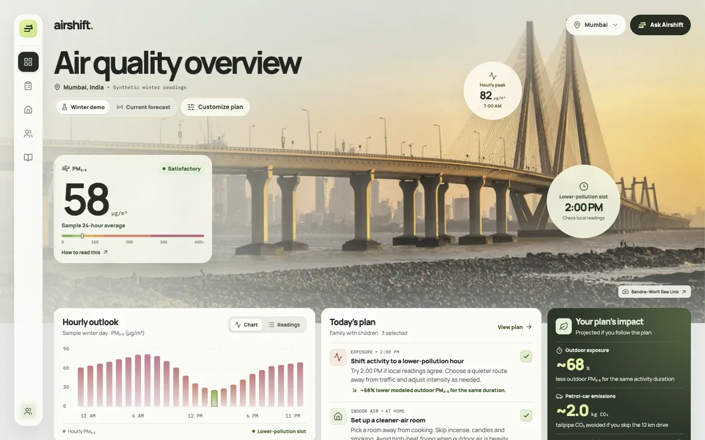
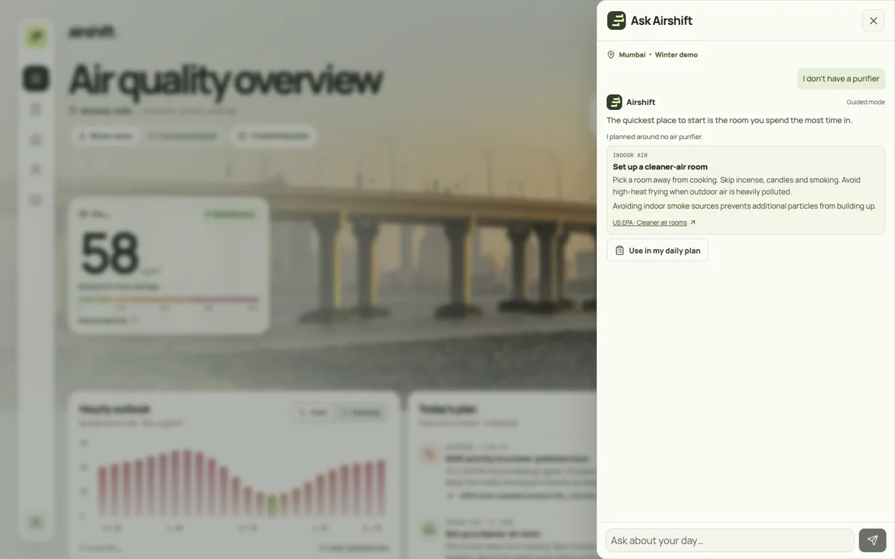
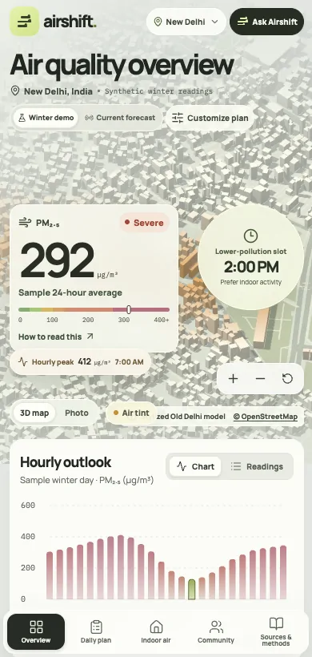
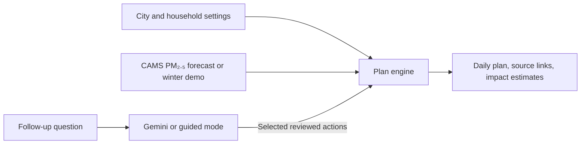

<div align="center">


<h1>Airshift</h1>

<p><strong>Turn an air-quality forecast into a plan your household can use.</strong></p>

<p>
  <a href="https://airshift-smog.jtnpanjio.chatgpt.site"></a>
  <a href="https://github.com/satiricalguru/Airshift"></a>
  <a href="https://ai.google.dev/gemini-api/docs/structured-output"></a>
  <a href="LICENSE"></a>
</p>

<p><a href="https://airshift-smog.jtnpanjio.chatgpt.site"><strong>Open Airshift</strong></a> · <a href="#quick-start">Quick start</a> · <a href="#see-it-in-action">Demo</a> · <a href="docs/methodology.md">Methodology</a></p>

<a href="https://airshift-smog.jtnpanjio.chatgpt.site"></a>

</div>

Built for **Prompt Wars Challenge 06**, Airshift helps families, outdoor workers, and community organizers decide what to do during urban air pollution. It turns regional PM₂.₅ and the constraints of an actual day into a plan for outdoor activity, indoor air, and travel. [Prompt Wars Virtual](https://promptwars.in/promptwarsVirtual.html)

## See it in action

<table>
<tr>
<td width="50%" valign="top">

<br><strong>Switch location and inspect the forecast</strong><br>
<sub>Compare 14 cities and switch between an hourly chart and exact readings.</sub>
</td>
<td width="50%" valign="top">

<br><strong>Ask about a real decision</strong><br>
<sub>Get a source-backed reply and add its actions to the daily plan.</sub>
</td>
</tr>
</table>

### A plan you can explain

| Decision | What Airshift shows |
| --- | --- |
| **Move outdoor play indoors** | In the synthetic Delhi scenario, moving the sample 30-minute session indoors avoids 30 outdoor minutes. |
| **Replace one petrol-car trip** | Skipping the sample 12 km drive at 14 km/L avoids about 2.0 kg of the car’s tailpipe CO₂. The model shows the fuel factor and what the estimate includes. |
| **Improve air at home** | A room-by-room checklist, no-purchase options, and a purifier sizing estimate based on floor area. |
| **Coordinate a group** | A briefing to copy for a school or residents’ group with current data status and a link to official readings. |

<details>
<summary><strong>More screenshots</strong></summary>

<table>
<tr>
<td width="50%" valign="top"><br><strong>Mumbai overview</strong></td>
<td width="50%" valign="top"><br><strong>Source-backed assistant</strong></td>
</tr>
</table>



</details>

## Quick start

Use Node.js 22.12 or newer.

```sh
git clone https://github.com/satiricalguru/Airshift.git
cd Airshift
npm ci
npm run dev
```

Open [localhost:5173](http://localhost:5173). The demo, regional forecasts, plan, and guided assistant work without an API key.

| Command | Purpose |
| --- | --- |
| `npm test` | Run planner, API, and hosted-runtime checks |
| `npm run build` | Build the browser application |
| `npm start` | Serve the production build at [localhost:8080](http://localhost:8080) |
| `npm run build:site` | Package the browser app and API as a deployable Worker |

Copy `.env.example` to `.env` and set `GEMINI_API_KEY` to enable the Gemini assistant on the server. The default model is Gemini 3.5 Flash-Lite. The hosted demo currently uses guided mode. [Google AI Studio keys](https://aistudio.google.com/apikey)

## How it works



- **Observation and prediction.** The current forecast uses Open-Meteo and CAMS at regional resolution. CPCB station readings are linked for local decisions. The synthetic winter scenario is labeled throughout. [Open-Meteo](https://open-meteo.com/en/docs/air-quality-api) · [CPCB](https://airquality.cpcb.gov.in/AQI_India/)
- **Grounded assistant.** Gemini returns structured action IDs and practical constraints. Airshift validates them and calculates impact from explicit inputs. [Gemini structured output](https://ai.google.dev/gemini-api/docs/structured-output)
- **Evidence and limitations.** [Methodology and credits](docs/methodology.md) · [Audit](AUDIT.md) · [Build narrative](BUILD-NARRATIVE.md)

## License

Airshift’s code is [MIT licensed](LICENSE). The Old Delhi map data is from OpenStreetMap contributors under ODbL, and city photography retains its individual Creative Commons licenses. [OpenStreetMap attribution](https://www.openstreetmap.org/copyright) · [Photo credits](docs/methodology.md#city-photography)
